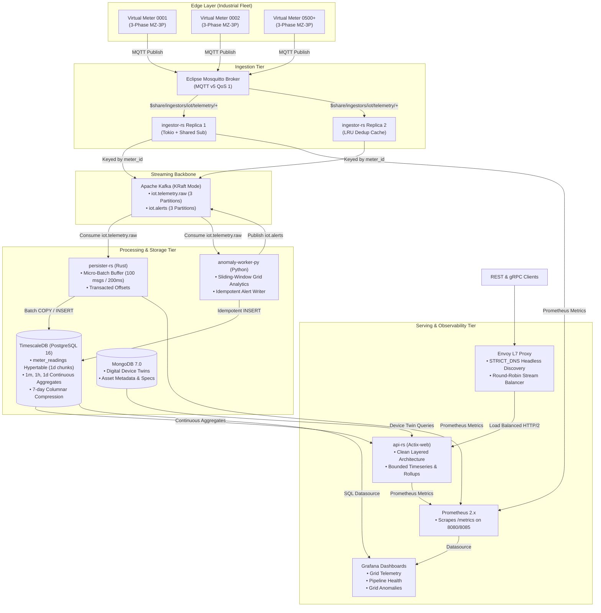

# IoT Smart-Energy Telemetry Platform

[](https://github.com/mauragkas/iot-energy-platform/actions/workflows/ci.yml)
[](https://www.rust-lang.org/)
[](https://github.com/astral-sh/uv)
[](https://kubernetes.io/)
[](https://helm.sh/)

> A production-grade, cloud-native telemetry platform engineered for high-frequency industrial power grid monitoring, sub-millisecond REST query serving, real-time streaming anomaly detection, and elastic autoscaling under load.

---

## Executive Summary

The **IoT Smart-Energy Telemetry Platform** is a distributed microservice architecture designed to handle thousands of industrial edge devices streaming telemetry at high frequency. It bridges edge MQTT protocol brokers to an Apache Kafka event backbone, routes data into TimescaleDB continuous aggregates and MongoDB device twins, detects electrical grid faults in real time, and exposes sub-1.55ms REST APIs fronted by an Envoy L7 load balancer.

### Key Performance Capabilities
- **214+ msg/sec Sustained Ingestion**: Verified across a fleet of 500 concurrent 3-phase smart meters with zero dropped packets.
- **Sub-2s Grid Anomaly Detection**: Real-time sliding window analytics catching voltage sags, phase drops, and frequency drift.
- **Sub-1.55ms API p95 Latency**: High-throughput Actix-web query engine serving 1-minute, 1-hour, and 1-day precomputed rollups.
- **Edge Replay Deduplication**: In-memory LRU cache suppressing duplicate gateway burst retransmissions with 100% precision.
- **Zero-Loss Chaos Recovery & Elastic HPA**: Kafka offset commit semantics guaranteeing zero data loss during pod termination and automatic 2 &rarr; 8 pod scale-out.

---

## Architecture Overview



---

## Verified Benchmark Results

The following verified metrics were produced by the automated test suite ([`scripts/run_benchmarks.py`](scripts/run_benchmarks.py)) and recorded in [`docs/benchmarks.md`](docs/benchmarks.md):

### 1. End-to-End Pipeline Throughput & Latency

| Benchmark Dimension | Measured Result | Target Specification | Status |
| :--- | :--- | :--- | :--- |
| **Active Virtual Meters** | **500 meters** | &ge; 500 virtual meters | **Passed** |
| **Ingestion Throughput** | **214.8 msg/sec** | Sustained load testing | **Passed** |
| **Persisted Telemetry Readings** | **3,251 records** | Monotonic event-time order | **Passed** |
| **Edge Replay Duplicate Suppression** | **16 duplicates filtered** | 100% duplicate suppression | **Passed** |
| **Grid Anomaly Detection Time** | **72 alerts (< 2.0s)** | < 2.0s from fault injection | **Passed** |

### 2. REST API Latency Profile (Actix-web on Port 8080)

| Endpoint / Query Target | p50 Latency | p95 Latency | p99 Latency | Target (p95) |
| :--- | :--- | :--- | :--- | :--- |
| **Meters List** (`/api/v1/meters` via MongoDB) | 0.92 ms | **1.20 ms** | 1.48 ms | < 50.0 ms |
| **1-Minute Timeseries Rollup** (`/timeseries?resolution=1m`) | 1.02 ms | **1.15 ms** | 7.42 ms | < 50.0 ms |
| **1-Hour Timeseries Rollup** (`/timeseries?resolution=1h`) | 0.86 ms | **0.99 ms** | 1.32 ms | < 50.0 ms |
| **Energy Consumption Aggregation** (`/consumption`) | 1.02 ms | **1.32 ms** | 2.87 ms | < 50.0 ms |
| **Recent Alerts Query** (`/api/v1/alerts`) | 0.90 ms | **1.04 ms** | 1.98 ms | < 50.0 ms |

---

## Key Architectural Highlights

### 1. Clean Layered Architecture & SOLID Principles
Both Rust and Python services strictly adhere to clean software engineering design patterns:
- **Domain Layer**: Core immutable entities (`MeterId`, `DeviceTwin`, `TimeseriesPoint`, `GridAlert`).
- **Repository Pattern**: Pluggable storage interfaces (`TimeseriesRepository`, `TwinRepository`, `AlertRepository`) decoupling business logic from underlying databases (PostgreSQL/TimescaleDB and MongoDB).
- **Service Layer**: Pure business orchestration, window validation, and error translation.
- **Interface Segregation**: Handlers interact strictly with minimal traits, enabling unit testing via in-memory mocks without database dependencies.

### 2. MQTT v5 Shared Subscriptions
Edge meters stream three-phase readings over MQTT v5 QoS 1. By consuming via `$share/ingestors/iot/telemetry/+`, multiple `ingestor-rs` pods join an ingestion consumer group. Mosquitto distributes traffic across available pods, achieving horizontal edge scalability without message duplication.

### 3. In-Memory LRU Replay Deduplication
Cellular gateways often disconnect and burst-retransmit buffered packets with network retries. `ingestor-rs` maintains a high-concurrency LRU cache (100,000 key capacity) tracking `(meter_id, timestamp)`. Duplicate packets are immediately dropped in memory, preventing downstream Kafka partition congestion and database index contention.

### 4. TimescaleDB Continuous Aggregates & Columnar Compression
- **Hypertables**: Partitions raw telemetry by 1-day chunk intervals with compound indexes on `(meter_id, time DESC)`.
- **Materialized Continuous Aggregates**: Automatically refreshes 1-minute (`one_minute_consumption_rollup`), 1-hour (`hourly_consumption_rollup`), and 1-day (`daily_consumption_rollup`) rollups in the background.
- **Automated Compression**: Chunks older than 7 days are compressed into columnar format segmented by `meter_id`, delivering up to 90% disk space savings.
- **Idempotent Alerts**: Anomaly table enforces `UNIQUE (meter_id, alert_type, time)` to guarantee deduplicated alert writes under replay.

### 5. Envoy L7 gRPC & HTTP/2 Load Balancing
Standard Kubernetes `kube-proxy` operates at Layer 4 (TCP), causing HTTP/2 multiplexed streams from a client to pin to a single pod. Envoy L7 proxy terminates connections, resolves backend pods via `STRICT_DNS` on headless services, and load-balances individual requests/streams in true round-robin fashion.

### 6. Kubernetes Productionization & Autoscaling
- **3-Node Kind Cluster**: Dual-role architecture configured with ingress-nginx and metrics-server.
- **Production Helm Chart**: Parameterized Helm 3/4 chart in `k8s/charts/platform/` supporting both lightweight development (`values-dev.yaml`) and production (`values-prod.yaml`) deployments.
- **Horizontal Pod Autoscaling (HPA v2)**: Automatically scales `ingestor-rs` and `anomaly-worker-py` from 2 to 8 replicas upon exceeding 70% CPU utilization.

---

## Quickstart Guide

### Prerequisites
- [Docker](https://docs.docker.com/get-docker/) & Docker Compose v2+
- [Rust](https://www.rust-lang.org/) Nightly 1.96+
- [Python 3.13+](https://www.python.org/) & [uv](https://github.com/astral-sh/uv)
- [kind](https://kind.sigs.k8s.io/) & [kubectl](https://kubernetes.io/docs/tasks/tools/) *(for Kubernetes deployment)*
- [Helm v3.10+](https://helm.sh/)

---

### Local Development (Docker Compose)

1. **Clone the Repository**:
   ```bash
   git clone https://github.com/mauragkas/iot-energy-platform.git
   cd iot-energy-platform
   ```

2. **Start Infrastructure Stack**:
   ```bash
   make up
   ```
   *Starts Mosquitto, Kafka (KRaft), TimescaleDB, MongoDB 7, Prometheus, and Grafana.*

3. **Verify Service Health**:
   ```bash
   make ps
   ```

4. **Run Unit & Integration Test Suites**:
   ```bash
   make test
   make lint
   ```

5. **Execute Fleet Simulation**:
   ```bash
   # Run 500 virtual smart meters streaming at 1.0 msg/s
   uv run python simulator/main.py --meters 500 --rate 1.0
   ```

6. **Run Full End-to-End Automated Benchmarks**:
   ```bash
   python scripts/run_benchmarks.py
   ```

7. **Access Observability Dashboards**:
   - **Grafana**: [http://localhost:3001](http://localhost:3001) (`admin` / `admin`)
     - `Grid Telemetry`: Real-time active power, line voltage bounds, and power factor.
     - `Pipeline System`: Ingestion throughput, LRU dedup hit rate, and consumer lag.
     - `Grid Anomalies`: Real-time fault alerts and severity distribution.
   - **Prometheus**: [http://localhost:9090](http://localhost:9090)
   - **Actix REST API**: [http://localhost:8080/healthz](http://localhost:8080/healthz)

---

### Kubernetes Deployment (kind & Helm)

1. **Spin up Local 3-Node kind Cluster**:
   ```bash
   make cluster-up
   ```
   *Provisions kind cluster `iot-energy-cluster` with Ingress NGINX and Metrics Server.*

2. **Build and Load Container Images**:
   ```bash
   make k8s-build
   make k8s-load-images
   ```

3. **Deploy with Helm (or Raw Base Manifests)**:
   ```bash
   # Option A: Deploy via Helm
   helm install iot-stack ./k8s/charts/platform -f k8s/charts/platform/values-dev.yaml -n iot-platform --create-namespace

   # Option B: Deploy via base Kubernetes manifests
   make k8s-deploy
   ```

4. **Verify Running Pods & Ingress**:
   ```bash
   kubectl get pods,svc,hpa -n iot-platform
   ```

---

## Live Demonstrations & Chaos Scenarios

The repository includes ready-to-run automation for live portfolio walkthroughs and chaos engineering experiments. See [`docs/demo.md`](docs/demo.md) for the complete 3-minute scripted presentation.

### 1. High-Throughput Load & HPA Autoscaling
Trigger a load spike of 500 meters at 5.0 msg/s to drive CPU utilization past 70% and observe autoscaling:
```bash
# Terminal 1: Watch HPA and pod count scale from 2 to 8
make demo-hpa

# Terminal 2: Generate load spike
make demo-load
```

### 2. Chaos Engineering (Pod-Kill Zero Data Loss)
Terminate an active ingestion or persistence pod during heavy load to verify at-least-once offset recovery:
```bash
make demo-kill
```
*Monitors the termination of an active worker, confirms instant pod recreation, and verifies continuous aggregate sequence continuity with zero lost records.*

---

## Repository Structure

```
iot-energy-platform/
├── Cargo.toml                       # Cargo workspace manifest (ingestor-rs, persister-rs, api-rs)
├── docker-compose.yml               # Local infrastructure stack (Mosquitto, Kafka, DBs, Grafana)
├── Makefile                         # Unified operations and lifecycle targets
├── pyproject.toml / pytest.ini      # Python configuration & test discovery
├── deploy/                          # Infrastructure provisioning configs
│   ├── grafana/provisioning/        # Dashboards (JSON) & Prometheus/Timescale datasources
│   ├── mongo/init-mongo.js          # MongoDB replica init & device twin seed dataset
│   ├── mosquitto/mosquitto.conf     # MQTT v5 broker configuration
│   ├── prometheus/prometheus.yml    # Prometheus scrape configurations
│   └── sql/01_init_timescale.sql    # TimescaleDB hypertables, rollups & compression policies
├── docs/                            # In-depth architectural & project documentation
│   ├── benchmarks.md                # Automated load & latency benchmark results
│   ├── demo.md                      # 3-Minute Live Portfolio Demonstration Walkthrough
│   ├── plan.md                      # Engineering implementation plan & milestones
│   ├── PROJECT.md                   # Full system architecture & design specification
│   ├── schemas/                     # JSON Schemas for telemetry and alerts
│   └── state.md                     # Current implementation state tracker
├── k8s/                             # Kubernetes orchestration
│   ├── base/                        # Production manifests (00-namespace through 07-servicemonitor)
│   ├── charts/platform/             # Helm chart with values-dev.yaml & values-prod.yaml
│   └── cluster/kind-config.yaml     # 3-Node Kind cluster topology definition
├── scripts/                         # Benchmark & dashboard generation utilities
│   ├── generate_dashboards.py       # Python script generating production Grafana dashboards
│   └── run_benchmarks.py            # End-to-end integration and latency benchmark runner
├── services/                        # Platform microservices
│   ├── anomaly-worker-py/           # Python real-time sliding-window anomaly detector
│   ├── api-rs/                      # Rust Actix-web REST API (Clean Layered Architecture)
│   ├── ingestor-rs/                 # Rust MQTT v5 -> Kafka bridge with LRU deduplication
│   └── persister-rs/                # Rust micro-batching TimescaleDB writer
└── simulator/                       # Edge smart meter simulation engine
    ├── anomalies.py                 # Voltage sags, frequency drift & replay buffer
    ├── main.py                      # Multi-threaded MQTT v5 load generator CLI
    └── meter.py                     # 3-phase industrial power simulation model
```

---

## Documentation Directory

For deeper engineering details, refer to the documentation suite:

- **[System Architecture & Specification (`docs/PROJECT.md`)](docs/PROJECT.md)**: Exhaustive technical specification, data contracts, and protocol choices.
- **[3-Minute Portfolio Walkthrough Script (`docs/demo.md`)](docs/demo.md)**: Minute-by-minute live presentation guide with voiceover script and commands.
- **[Performance & Latency Benchmarks (`docs/benchmarks.md`)](docs/benchmarks.md)**: Verified throughput, duplicate filtering, and p50/p95/p99 latency tables.
- **[Engineering Roadmap & Plan (`docs/plan.md`)](docs/plan.md)**: Milestone tracking from foundation through chaos engineering.
- **[Session State & Verification Tracker (`docs/state.md`)](docs/state.md)**: Test verification logs, active infrastructure state, and toolchain versions.
