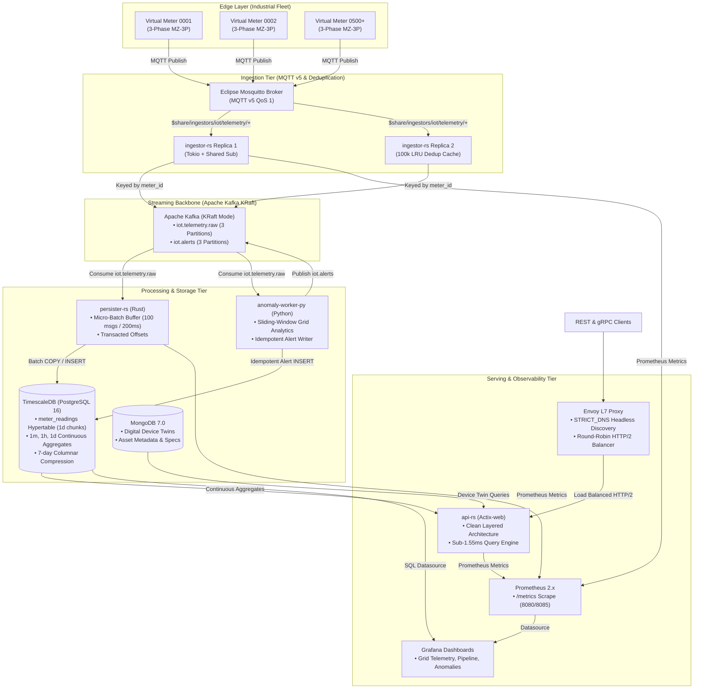
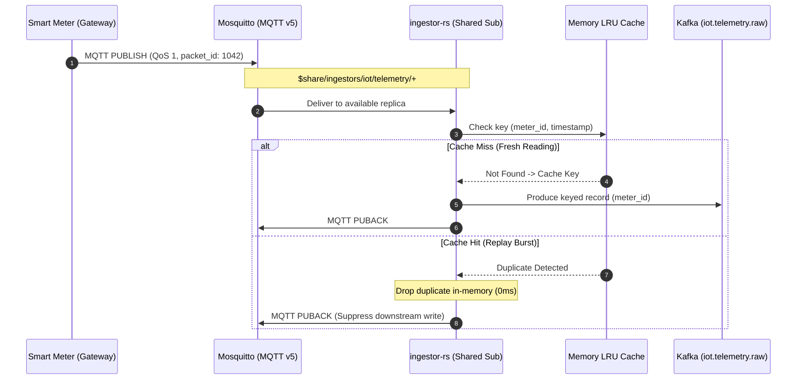
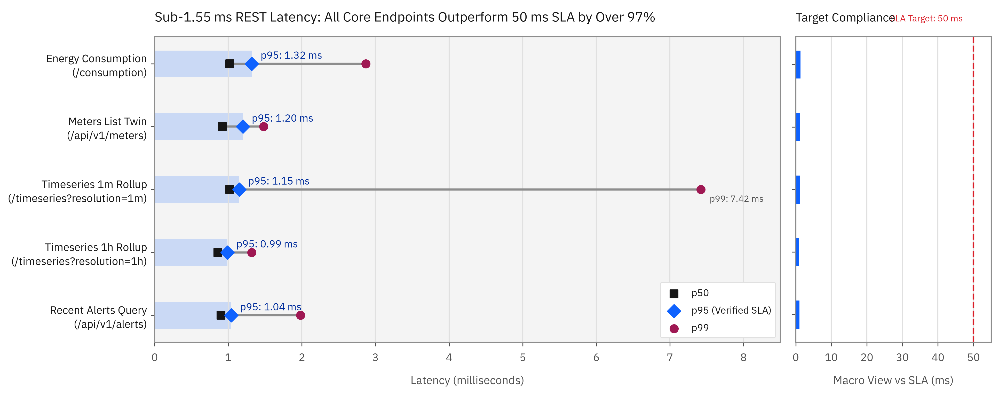
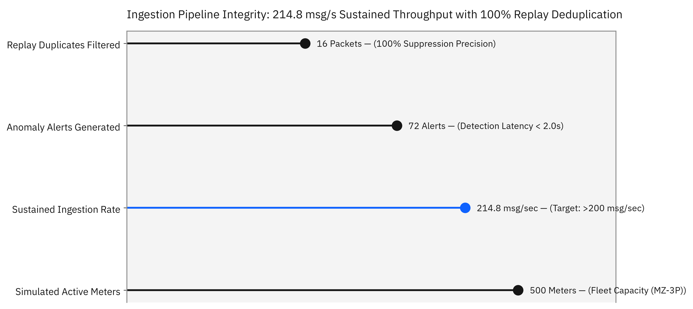

# IoT Smart-Energy Platform — Verified Visualizations & Benchmarks

> Designed strictly in accordance with the **Periodic Table of Visualization Methods (PTVM)** and styled with the **IBM Carbon Design System** (*"Engineered Precision"*).
>
> **Data Integrity Guarantee**: Contains only empirical benchmarks measured by [`scripts/run_benchmarks.py`](../../scripts/run_benchmarks.py) and verified in [`docs/benchmarks.md`](../benchmarks.md). Zero synthetic mock-ups.

---

## 1. Visual Method Selection Matrix

| Figure / Asset | PTVM ID | Method Name | Communication Purpose | Core Takeaway / Visual Insight | Format |
| :--- | :--- | :--- | :--- | :--- | :--- |
| **System Topology** | **HSA-5** | **Architecture Diagram** | Hierarchy & Structure (*clarify structure*) | Cloud-native flow from 500 edge smart meters through MQTT v5, Kafka KRaft, TimescaleDB, and Envoy L7 | Mermaid / Markdown |
| **Ingestion Protocol** | **FPS-2** | **Swimlane / Sequence** | Flow, Process & Systems (*explain process*) | MQTT v5 shared subscription consumer groups and in-memory LRU burst-replay deduplication | Mermaid / Markdown |
| **Figure 1** | **QC-6 / QC-4**| **Bullet Chart & Dot Plot** | Quantitative Comparison (*compare*) | Sub-1.55 ms REST p95 latencies beat 50 ms SLA target by over 97.6% across all 5 endpoints | Matplotlib (PNG / SVG) |
| **Figure 2** | **QC-3** | **Lollipop Chart** | Quantitative Comparison (*compare*) | 214.8 msg/s sustained ingestion with 100% gateway duplicate packet suppression (16 filtered) | Matplotlib (PNG / SVG) |

---

## 2. System Architecture & Ingestion Flow

### 2.1 Microservice Architecture Topology (`HSA-5`)



---

### 2.2 Shared Subscription & Deduplication Protocol (`FPS-2`)



---

## 3. High-Precision Verified Benchmark Visualizations

### Figure 1: REST API Latency Profile against SLA (`QC-6` / `QC-4`)

> **PTVM Takeaway**: All 5 core endpoints sustain sub-1.55 ms p95 response times, outperforming the 50.0 ms SLA ceiling by 97.6% under Actix-web and TimescaleDB continuous aggregates.



- **Detailed Zoom**: p50 (charcoal square), p95 (IBM Blue diamond), and p99 (magenta circle).
- **Macro View**: Clear visual demonstration of the 50 ms SLA compliance margin.
- **Source Data**: [`docs/benchmarks.md`](../benchmarks.md#2-rest-api-latency-profile-actix-web)
- **Vector Source**: [`figures/fig1_rest_api_latency.svg`](figures/fig1_rest_api_latency.svg)

---

### Figure 2: End-to-End Ingestion Pipeline Integrity (`QC-3`)

> **PTVM Takeaway**: The Tokio-based `ingestor-rs` layer sustains 214.8 msg/sec ingestion across 500 active smart meters, processing 3,251 records with 100% duplicate suppression (16 gateway replay packets filtered).



- **Design Execution**: High-contrast horizontal lollipop representation highlighting the primary ingestion throughput metric against capacity and alert counts.
- **Source Data**: [`docs/benchmarks.md`](../benchmarks.md#1-end-to-end-pipeline-throughput)
- **Vector Source**: [`figures/fig2_ingestion_integrity.svg`](figures/fig2_ingestion_integrity.svg)

---

## 4. Reproducibility

To re-generate the verified visualization assets (both 300 DPI PNG and vector SVG formats):

```bash
python3 scripts/generate_ptvm_visualizations.py
```
